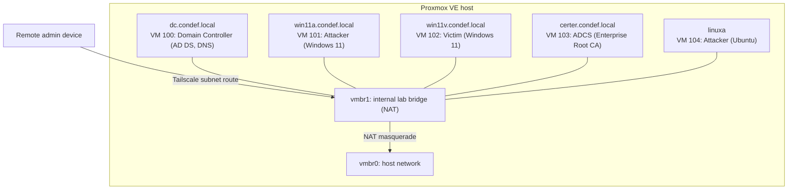

# ConDef Homelab

## Overview

ConDef is a purple-team practice lab built on Proxmox VE. The lab covers Windows Active Directory, Active Directory Certificate Services (ADCS), Linux attack infrastructure, endpoint telemetry, and detection engineering. All VMs run on an internal virtual bridge with NAT. A Tailscale mesh VPN provides remote access to the lab subnet.

## Architecture

The lab runs on a single Proxmox VE host. All VMs connect to an internal virtual bridge (vmbr1) with NAT to the host bridge (vmbr0).

| VM ID | Hostname | Role | OS |
|---|---|---|---|
| 100 | dc.condef.local | Domain Controller, AD DS, DNS | Windows Server 2019 |
| 101 | win11a.condef.local | Attacker host | Windows 11 Pro |
| 102 | win11v.condef.local | Victim host | Windows 11 Pro |
| 103 | certer.condef.local | ADCS, Enterprise Root CA | Windows Server 2019 |
| 104 | linuxa | Attacker host (C2 tooling) | Ubuntu |

## Active Directory

The Domain Controller (VM 100) runs AD DS on Windows Server 2019. I promoted the server to a new forest at `condef.local` with functional level 2016. The DC also serves as the DNS server for the lab subnet.

Two Windows 11 Pro clients (VM 101, VM 102) are domain-joined to `condef.local`. Both run Sysmon for endpoint telemetry. I created a domain user account and added it to the local Remote Desktop Users group on each client. RDP is enabled on all Windows VMs.

A Windows Auditing GPO configures process creation auditing and logon auditing across the domain.

## ADCS

Certer (VM 103) runs Active Directory Certificate Services on Windows Server 2019. I installed the ADCS role and configured an Enterprise Root CA for the domain. The CA issues certificates for domain users and computers.

## Linux Attack Infrastructure

Linuxa (VM 104) is an Ubuntu attacker host on the lab subnet. It is not domain-joined; it interacts with the domain over the network the way real attack infrastructure would.

## Network

All VMs connect to vmbr1, an internal Linux bridge on the Proxmox host. The bridge uses NAT masquerade to route traffic to vmbr0 (the host network). The lab subnet is `<lab-subnet>/24`. The gateway is `.1` and the DNS server is `.2` (the DC).

Tailscale subnet routing provides access to the lab subnet over a WireGuard mesh. This replaces SSH tunneling for RDP access. The entire `/24` subnet is reachable from any device on the Tailscale network.

## Security Hardening

The Proxmox host uses these security controls:

- SSH key-only authentication (password auth disabled)
- Root login restricted to SSH key (`PermitRootLogin prohibit-password`)
- SSH listener bound to the Tailscale interface only
- Web UI (port 8006) restricted to the Tailscale network via Proxmox firewall rules
- WebAuthn passkey for web UI login
- Tailscale certificate for HTTPS on the web UI

## Telemetry

Wazuh SIEM/EDR is deployed across the lab environment. Sysmon runs on all Windows endpoints. All traffic is routed and encrypted via Tailscale mesh VPN to prevent public internet exposure.

## Technologies

Proxmox VE, Windows Server 2019, Windows 11 Pro, Ubuntu, Active Directory Domain Services, Active Directory Certificate Services, Group Policy Objects, DNS, Sysmon, Wazuh, Tailscale, PowerShell